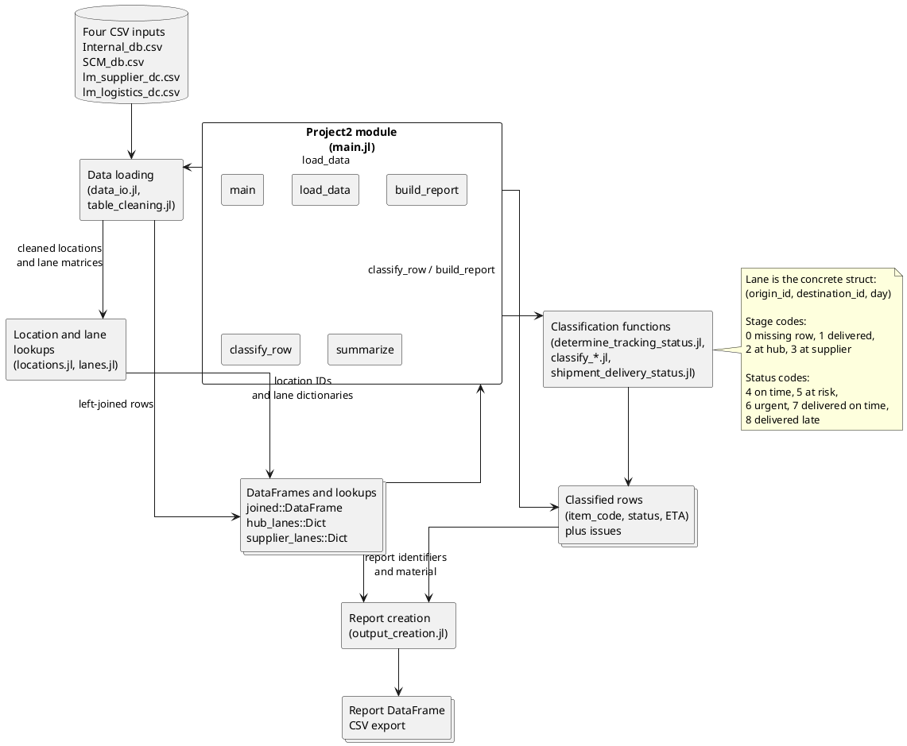
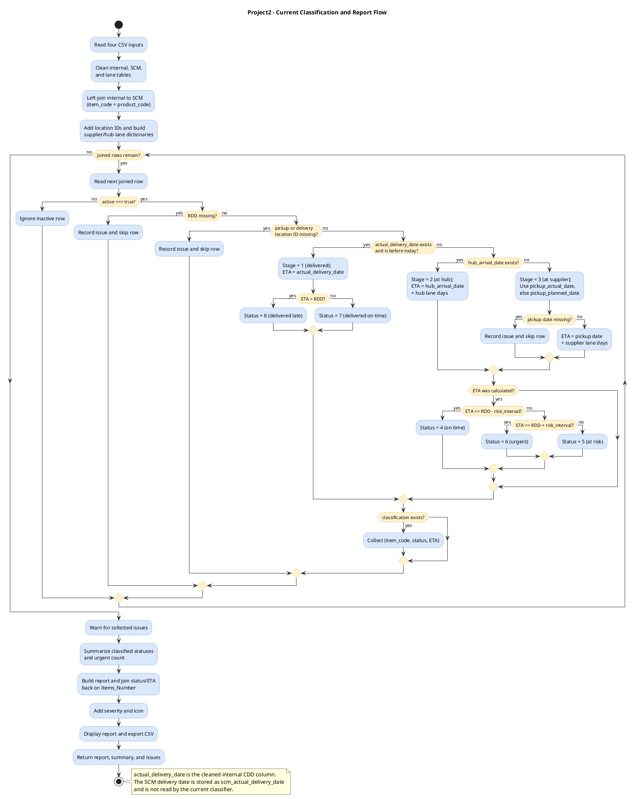
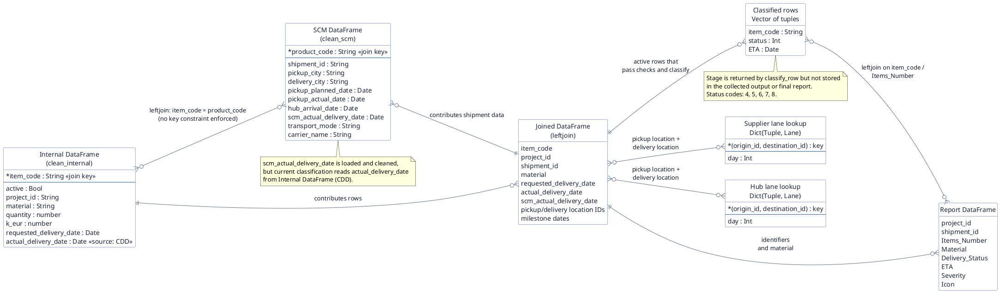

# Project design

Project2 is implemented as a functional Julia module that loads CSV files into
DataFrames, cleans and joins the input tables, classifies active order items,
and builds a report. The diagrams below describe the current implementation,
including its numeric stage and delivery-status codes.

UML diagrams provided in a `plantuml` block are automatically rendered when the
documentation is built. You can find the PlantUML documentation [here](https://plantuml.com/).

---

# Components (Implementation Diagram)

## Components and responsibilities

`load_data` reads four CSV files, cleans the internal and SCM tables, left-joins
them on `item_code` to `product_code`, adds location IDs, and builds supplier and
hub lane dictionaries. Each lane dictionary is keyed by an
`(origin_id, destination_id)` tuple and stores `Lane` values.

`build_report` processes active joined rows, skipping rows with a missing
requested delivery date or location IDs and recording those skips as issues.
`classify_row` selects a tracking stage, calculates an ETA, and returns a named
tuple `(stage, status, eta)`. `build_report` collects successful classifications
as `(item_code, status, eta)` tuples. Stage and delivery status values are
integer codes, not Julia enum types.

`main` summarizes the collected statuses and creates the report by joining
classified status/ETA values back to the project, shipment, item, and material
columns. It logs skipped-row issues, displays the report, exports it as CSV,
and returns the report, summary, and issues.

> **Current implementation detail:** `clean_internal` maps the internal `CDD`
> column to `actual_delivery_date`; `clean_scm` maps SCM `Leg n, Delivery
> Actual (date)` to `scm_actual_delivery_date`. The current stage detector and
> delivered-item classifier read `actual_delivery_date`, not
> `scm_actual_delivery_date`. Consequently, as currently implemented, the
> delivered branch uses the internal CDD value. This is reflected in the
> activity and data diagrams below.

---

# Activity Diagram (Classification and Report Flow)

---

# Entity Relationship Diagram (Input and Output Data)

